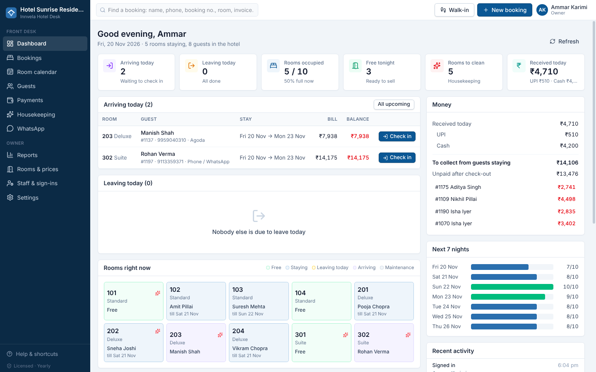
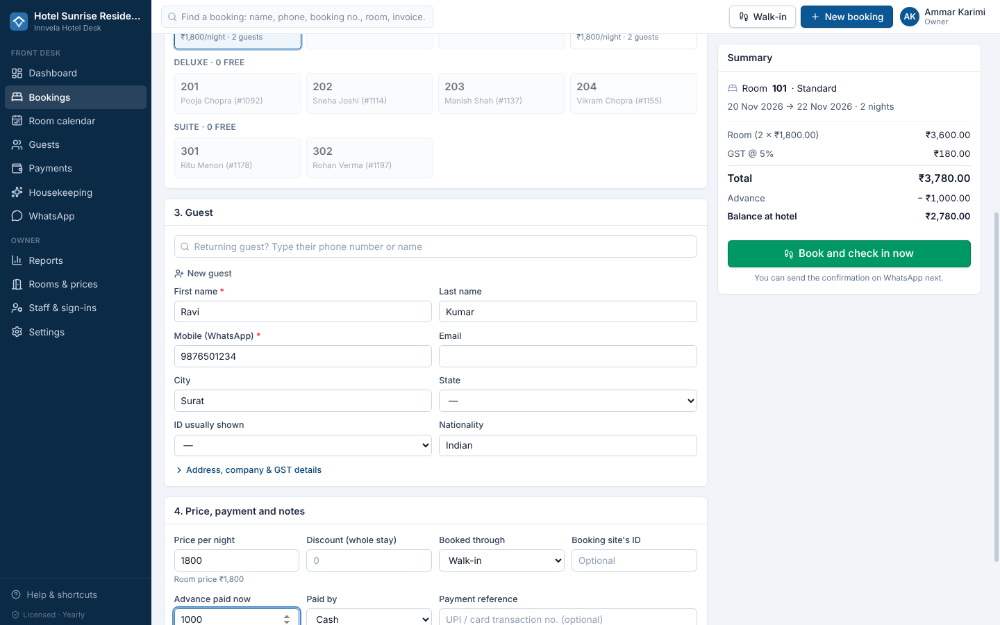
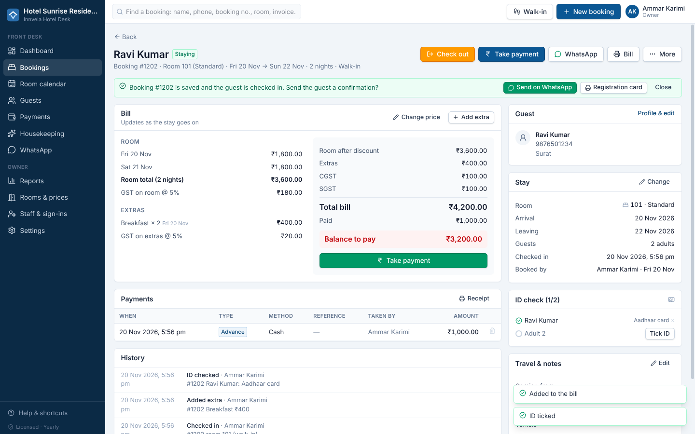
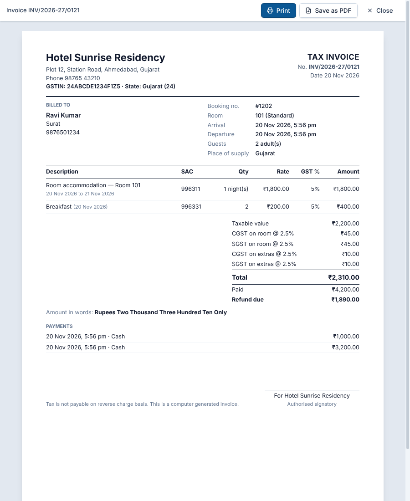
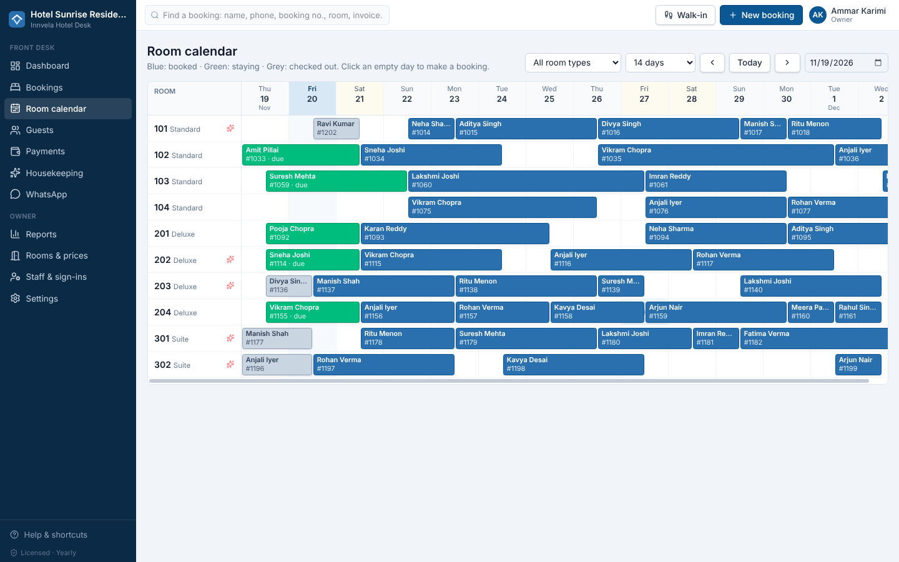
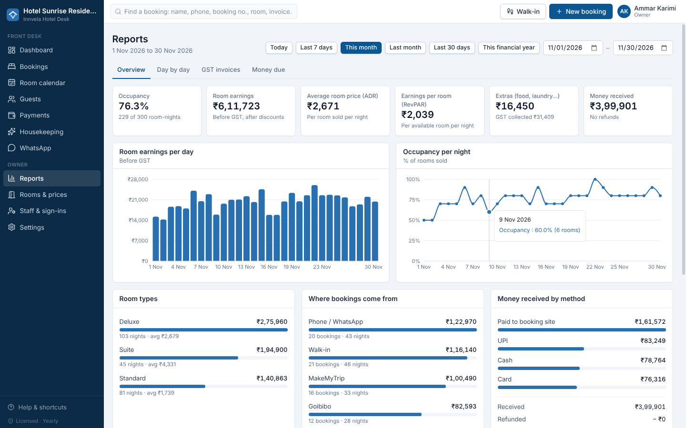
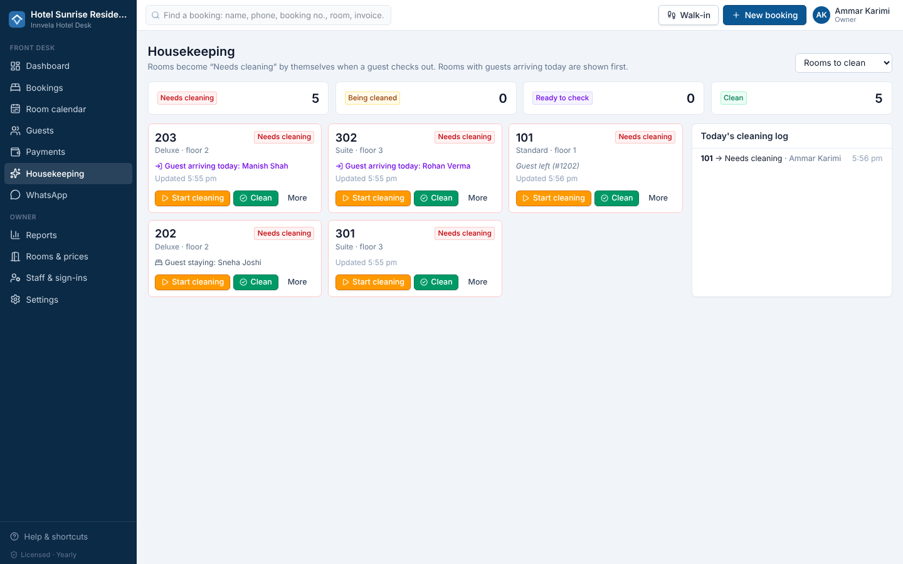
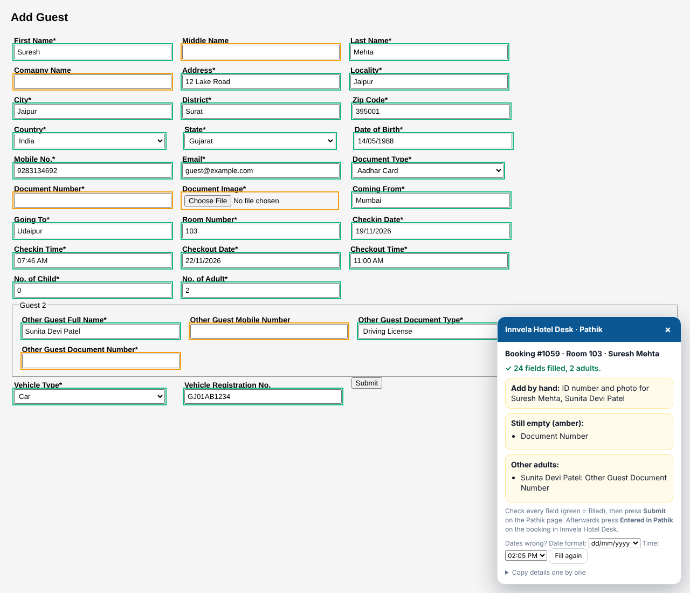

# Innvela Hotel Desk — offline hotel software for Windows

Desktop software for small and mid-size hotels, guest houses and homestays. It installs once
and then **runs completely on the hotel's own computer**: every booking, guest, bill and payment
is stored in a database file on that PC. No internet, no server and no hosting cost. Hotels pay
a **monthly or yearly licence**, entered as a key that only works on their computer.



## What it does

| Area | Features |
|---|---|
| **Dashboard** | Arrivals with one-click *Check in*, departures with *Check out*, every room's state (free / staying / leaving / arriving / maintenance / needs cleaning), money received today by cash / UPI / card, money still to collect, the next 7 nights, recent activity |
| **Bookings** | New booking on one screen: dates with quick “2 nights” buttons → free rooms with the price for the whole stay → returning-guest search by phone / name or a new guest → price, discount, source (walk-in, phone, MakeMyTrip, Booking.com…), booking site's ID, advance payment. **Walk-in** books and checks in together. No double bookings: the room is checked inside a database transaction |
| **Room calendar** | Tape chart of every room for 7 / 14 / 21 / 31 days. Click an empty day to book that room, click a stay to open it |
| **Check-in & check-out** | Early arrival, extend stay, move room, change dates, undo check-in, no-show, cancel, bring a booking back. At check-out you choose to bill the nights stayed or the nights booked; the room is marked for cleaning by itself |
| **GST bills** | Indian GST slabs by nightly price (0% up to ₹1,000, 5% up to ₹7,500, 18% above — editable), or one flat rate, or no tax. Prices with or without GST included. GST on food and extras. Invoice numbers per financial year (`INV/2026-27/0001`). **Tax invoice** with GSTINs, SAC codes, CGST/SGST, amount in words and a **UPI QR** for any balance; proforma bill; booking confirmation; guest registration card (with Form C details for foreign guests); payment receipt. Print or save as PDF |
| **Payments** | Cash, UPI, card, bank transfer, paid to the booking site; advances, part payments and refunds; totals by method and by staff member; Excel (CSV) export |
| **ID check** | Tick each adult's ID after seeing the original (Aadhaar, passport, driving licence…). Only the ID type, the last 4 characters (optional), who checked and when are saved — never a copy. Check-in warns when IDs are missing |
| **Housekeeping** | Needs cleaning → being cleaned → ready to check → clean. Rooms with guests arriving today come first. Out-of-order rooms. A *Housekeeping* role sees only this board |
| **Staff sign-ins** | Every person signs in with their own name and password. Roles: owner, manager, front desk, housekeeping. Front-desk **shifts**: start with the last handover note, end with a handover note and the cash counted; the owner sees sign-in times, hours, cash taken vs counted and the full history of who did what |
| **WhatsApp messages** | Booking confirmation, welcome at check-in, thank-you at check-out (with the invoice number and Google review link) and payment reminder — filled in from the booking, in the owner's own wording, opened in WhatsApp Desktop or WhatsApp Web ready to send. Every message is logged |
| **Pathik automation** | For hotels in Gujarat: *Fill in Pathik* opens Pathik (the police guest register, pathik.guru) in its own window and fills its **Add Guest** form from the booking — name, address, district, PIN, state, date of birth, mobile, email, ID type, journey, room, check-in/out dates and times, adults, children, vehicle — and a block for **every other adult** in the room with their name and ID type. The Pathik sign-in is remembered. It lists what Pathik still needs and lets you add it on one screen. Staff add the ID number and photo, press Submit in Pathik, then mark the stay *Entered in Pathik*; the Dashboard lists guests not entered yet. No Chrome extension is needed |
| **Reports** | Any dates: occupancy, room earnings, ADR, RevPAR, extras, GST collected, money received by method, room types, booking sources, cancellations; charts per day; day-by-day table; **GST invoice register** and GST by rate (for GSTR-1 / 3B); guests who still owe money. Everything downloads for Excel |
| **Also** | Guest profiles with stay history, VIP and “do not allow” flags; rooms, weekend prices and festival / off-season prices; automatic daily backups; first-run setup wizard; optional sample data for training |

| | |
|---|---|
|  |  |
|  |  |
|  |  |
|  | |

---

## For you, the seller

### 1. Make your licence signing key (once)

```bash
npm install
npm run license:init
```

This creates:

- `tools/license/private-key.pem` — **your secret**. Back it up (password manager, USB drive).
  Never share or commit it (it is in `.gitignore`). If you lose it you cannot issue licences for
  copies already installed.
- `electron/license-public-key.ts` — the public half, built into the app. **Commit this file.**

Until you do this the repository uses a demo key, and `npm run build` refuses to package the
app, because anyone could make licences for the demo key.

### 2. Build the installer

**On GitHub (recommended):** push the code, then *Actions → Build Windows installer → Run
workflow*. When it finishes, download the *Artifacts*:

- `Innvela-Hotel-Desk-Setup-1.0.0.exe` — the normal installer (desktop and Start-menu shortcuts)
- `Innvela-Hotel-Desk-Portable-1.0.0.exe` — runs without installing
- `Innvela-Hotel-Desk-1.0.0-win-x64.zip`

Pushing a tag such as `v1.0.1` builds the same files and publishes them as a GitHub Release.
Raise `"version"` in `package.json` for each new release.

**On a Windows PC:** install Node.js 22, then `npm install` and `npm run dist:win`. The files
appear in `release/`.

### 3. Give hotels the download link

Upload `Innvela-Hotel-Desk-Setup-x.y.z.exe` anywhere (Google Drive, Dropbox, your website, a
GitHub Release) and send the link. The link does not have to be secret: the software only
runs beyond its free trial with a licence key made for that hotel's computer. Without a code-signing
certificate Windows shows “Windows protected your PC” the first time; the hotel clicks *More
info → Run anyway*. To remove that warning, buy a code-signing certificate and set `CSC_LINK` /
`CSC_KEY_PASSWORD` in the build (see electron-builder's docs).

### 4. Sell monthly or yearly licences

1. The hotel installs the software. It works free for **15 days** (`TRIAL_DAYS` in `electron/license.ts`).
2. They open *Settings → Licence* (or the screen shown when the trial ends) and send you
   **this computer's code**, for example `F158-F8C2-82DA-A7AA`.
3. When they pay, you make their key:

   ```bash
   npm run license:new -- --to "Hotel Sunrise" --plan monthly --machine F158-F8C2-82DA-A7AA
   npm run license:new -- --to "Hotel Sunrise" --plan yearly  --machine F158-F8C2-82DA-A7AA --rooms 20
   npm run license:new -- --to "Hotel Sunrise" --until 2027-03-31 --machine F158-F8C2-82DA-A7AA
   ```

   It prints the key and saves a `.lic` file. Send either one on WhatsApp or email. Every key
   you issue is listed in `tools/license/issued-licenses.csv`.
4. They paste the key (or open the `.lic` file) and press *Activate*.
5. To renew, make a new key with the new end date. 10 days before the end the app reminds
   them. After the end date they get **5 more days**, then the app shows only the licence screen
   until a new key is entered. Their data is never deleted, and they can still save a backup.

Options: `--plan monthly | quarterly | yearly | lifetime`, `--from YYYY-MM-DD` (start of the
period), `--until YYYY-MM-DD` (exact end), `--rooms N` (most rooms allowed), `--machine any`
(a key for any computer: use with care).

Keys are signed with Ed25519, so they cannot be forged or edited without your private key.
Moving the clock back does not extend a licence.

---

## For the hotel

1. Run the installer. On first start a short wizard asks for the hotel's details, the owner's
   password and the rooms (or fills in sample data for training).
2. Add staff in *Staff & sign-ins*. Each person signs in with their own name.
3. Install **WhatsApp Desktop** and link it to the hotel's phone (*WhatsApp → Linked devices*).
   Messages open there ready to send. WhatsApp Web can be chosen instead in *Settings → WhatsApp*.
4. **Backups:** everything is stored in `%APPDATA%\Innvela Hotel Desk\data\hotel.db`. A
   backup copy is made every day and whenever the software is closed, in
   `Documents\Innvela Backups`. Choose a folder on a USB drive or inside Google Drive / OneDrive in
   *Settings → Backups* so the data survives if the computer breaks. *Restore from file* brings a
   backup back (a copy of the current data is saved first).

5. **Pathik (Gujarat):** switched on by itself when the hotel is in Gujarat (or in *Settings → Front
   desk*). After check-in press *Fill in Pathik* on the booking. Sign in to Pathik the first time
   (it is remembered), check the filled form, add the ID number and photo, press Submit, then press
   *Entered in Pathik*. If Pathik shows dates or times in another format, change it in the small
   panel on the Pathik page or in *Settings → Front desk*.

Keyboard: `Ctrl+B` new booking, `Ctrl+K` find a booking, `Esc` close a window.

---

## For developers

Electron 45 + React 19 + Tailwind CSS 4 + SQLite (Node's built-in `node:sqlite`, so there are no
native modules to rebuild).

```bash
npm install
npm run dev        # Vite dev server + Electron
npm test           # pricing, GST, dates, messages, licence keys
npm run typecheck
npm run build      # checks the licence key, type-checks, builds dist/ and dist-electron/
npm start          # runs the built app
```

`INNVELA_DATA_DIR=/some/folder npm start` runs with a separate data folder (useful for testing). This
and `VITE_DEV_SERVER_URL` only work in a development copy; the installed software ignores them.

```
electron/            main process — the only code that touches the database
  main.ts            window, menu, printing, file dialogs, WhatsApp links
  db.ts              SQLite connection, helpers, schema migrations
  license.ts         licence check, trial, machine code
  backup.ts          daily backups, save copy, restore
  pathik.ts          the Pathik window (its own saved session) and when to fill the form
  pathik-page.js     runs inside Pathik's page: finds fields by their labels and fills them
  api/               one module per area; every request is checked against role and licence
shared/              code used by both sides: GST & bill maths, dates, WhatsApp templates, types
src/                 the screens (React)
  pages/             Dashboard, Bookings, NewBooking, BookingDetail, Calendar, Guests, Payments,
                     Housekeeping, WhatsApp, Reports, Rooms, Staff, Settings, Setup, Login…
  print/             invoice, confirmation, registration card, receipt, GST register
tools/license/       the seller's tools: make the signing key, issue licence keys
.github/workflows/   builds the Windows installer
```

The screens call the database through one IPC channel (`window.innvela.call("bookings.create", …)`,
see `electron/api/index.ts`). The renderer runs sandboxed with context isolation and a strict
content security policy, and can only open WhatsApp / mail / phone links outside the app.

Security, in short:

- The screens run sandboxed with no Node.js; the main process accepts requests only from the app's
  own pages, checks the signed-in person's role on every request, and limits sign-in attempts
  (5 wrong passwords lock the name for 30 seconds, then longer).
- Files are read or written only where the person chose in a file dialog (or the listed backups).
- The installed build has developer tools off and Electron fuses set: it cannot be started as
  Node.js, ignores `NODE_OPTIONS` and `--inspect`, and loads only its own (integrity-checked) app
  archive. On Windows the trial start is also kept in the registry, so deleting the data folder does
  not restart the trial.
- Text exported to Excel cannot run as a formula.

Schema changes: add a new entry at the end of `MIGRATIONS` in `electron/db.ts` (never edit one
that has shipped). Each installation upgrades its database when it starts.

The business rules (GST slabs, invoice snapshot at check-out, WhatsApp wording) follow the
web version in the `hotel-booking` repository.
